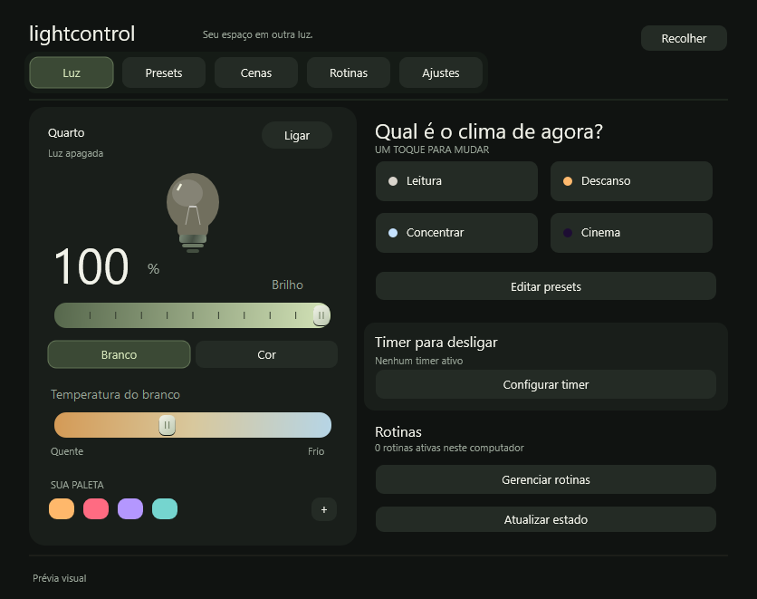
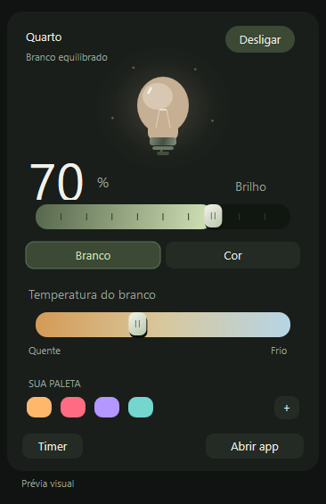
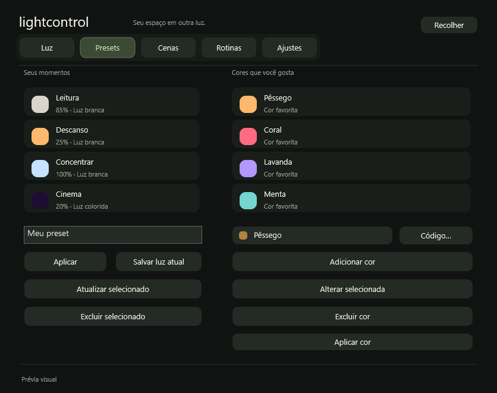
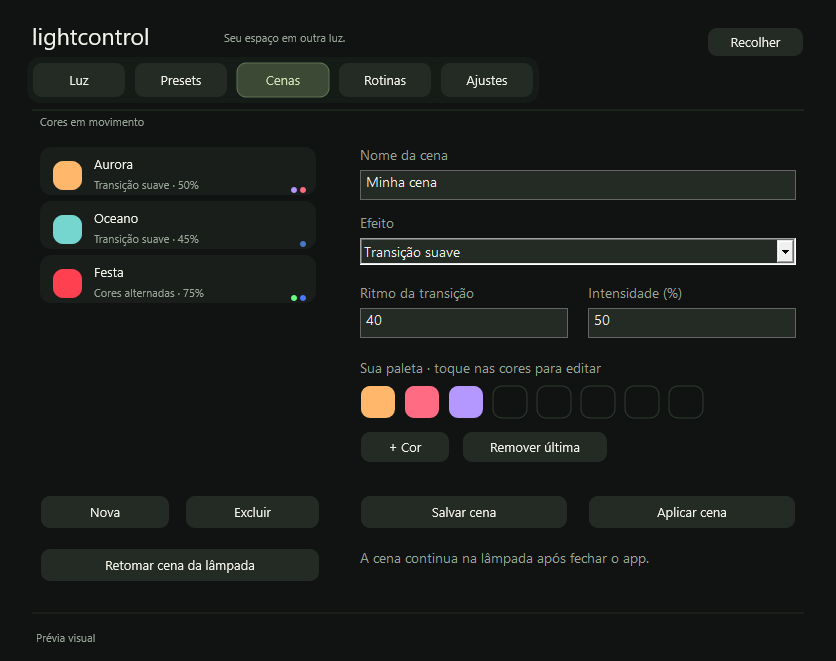
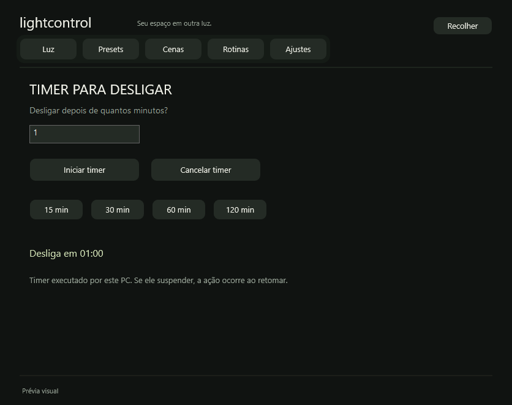
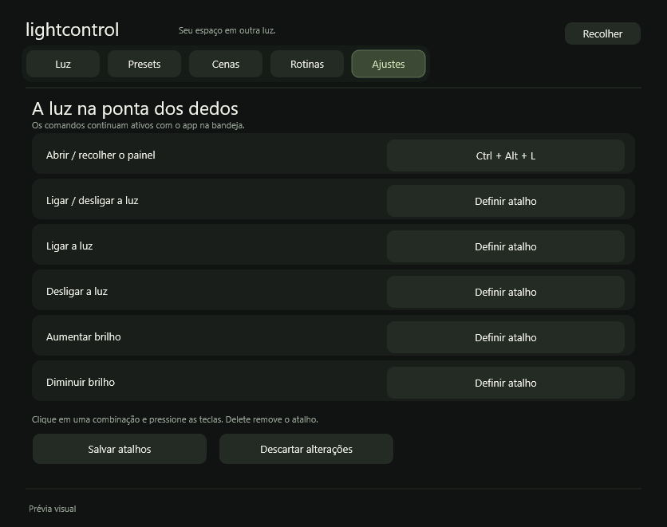

# LightControl

Controle nativo, ultraleve e 100% local de iluminação inteligente Tuya (protocolo 3.5) para **Windows 10/11** e **Android 11+**.

Sem nuvem, sem telemetria, sem WebView e sem runtime pesado. Apenas conexões diretas na rede local (LAN).



---

## Destaques

- **100% Local (LAN):** Comunicação TCP direta na porta 6668 usando protocolo Tuya 3.5 com criptografia CNG/AES-GCM. Não depende de internet nem de servidores externos.
- **Nativo e Ultraleve:**
  - **Windows:** Desenvolvido em Rust com Win32 puro, renderização vetorial com Direct2D e tipografia DirectWrite. Um único processo de baixo consumo de memória.
  - **Android:** App nativo em Java puro com integração ao **Device Control** da Samsung One UI e do sistema Android.
- **Privacidade e Segurança:**
  - No Windows, as credenciais do dispositivo são cifradas com **DPAPI** no perfil do usuário.
  - No Android, os segredos são protegidos no **Android Keystore**.
  - Nenhuma chave ou identificador trafega em texto puro ou é versionado no código.
- **Dois Modos no Windows:** Janela completa ou mini painel flutuante acoplado à bandeja do sistema (System Tray).

---

## Interface

| Luz e Cores | Mini Painel na Bandeja | Presets Rápidos |
| :---: | :---: | :---: |
|  |  |  |

| Cenas Dinâmicas | Temporizador | Atalhos Globais |
| :---: | :---: | :---: |
|  |  |  |

---

## Funcionalidades

- **Controle de Luz:**
  - Alternância imediata de energia (liga/desliga).
  - Brilho de branco e temperatura de cor (branco quente a frio relativo).
  - Modo colorido com seletor HSV completo, paleta de favoritas e código hexadecimal.
  - Ajustes com a lâmpada apagada ficam preparados em memória e são aplicados em lote ao ligar.
- **Mini Painel da Bandeja:** Acesso rápido próximo ao relógio com menu de contexto completo (clique direito) e fechamento ao clicar fora.
- **Presets Customizáveis:** Salve e restaure perfis com um clique ou atalho rápido (ex: *Leitura*, *Descanso*, *Concentrar*, *Cinema*).
- **Cenas Embarcadas:** Crie cenas com até 8 cores, transições suaves e velocidades customizadas, executadas diretamente pelo microcontrolador da lâmpada.
- **Timer Inteligente:** Temporizador nativo (1 a 1440 min) executado pelo próprio firmware do dispositivo, permanecendo ativo mesmo se o aplicativo for fechado.
- **Rotinas Locais:** Automações baseadas em horário e dias da semana executadas em segundo plano.
- **Atalhos de Teclado Globais:** Controle total da iluminação mesmo com o app minimizado na bandeja.

---

## Atalhos de Teclado

| Atalho | Ação |
| :--- | :--- |
| `Ctrl + Alt + L` | Abrir / recolher mini painel da bandeja |
| `Ctrl + 1` | Aba de Luz (controle principal) |
| `Ctrl + 2` | Aba de Presets |
| `Ctrl + 3` | Aba de Cenas |
| `Ctrl + 4` | Aba de Rotinas |
| `Ctrl + 5` | Aba de Ajustes e Conexão |
| `Ctrl + T` | Temporizador rápido |
| `Tab` / `Shift + Tab` | Navegar entre controles da tela |
| `Espaço` | Ativar botão ou controle selecionado |
| `Setas` / `Page Up` / `Page Down` | Ajustar sliders de brilho, temperatura e matiz |
| `Esc` | Voltar para tela inicial ou fechar mini painel |
| `F5` | Forçar sincronização de estado com o dispositivo |

*Os atalhos de energia e ajuste podem ser personalizados livremente em **Ajustes → Personalizar atalhos…**.*

---

## Como Compilar

### Versão Windows (Rust)

**Requisitos:** Rust estável com o target `x86_64-pc-windows-gnu` ou `x86_64-pc-windows-msvc`.

```powershell
# Compilar binário de release otimizado
.\build.ps1

# Executar suíte de testes unitários
.\build.ps1 -Test
```

O executável final é gerado em `dist\LightControl.exe`.

Para iniciar rapidamente em modo de desenvolvimento:
```cmd
run.bat
```

### Versão Android (Java)

Consulte o guia dedicado em [`android/README.md`](android/README.md).

```powershell
# Configurar dependências e SDK isolado
.\android\bootstrap.ps1

# Compilar pacote APK de release
.\android\build.ps1
```

O pacote APK final é gerado em `dist\LightControl-Android.apk`.

---

## Segurança e Configurações

1. **Primeira Conexão:** Ao iniciar pela primeira vez, abra a aba **Ajustes** e insira o endereço IP da lâmpada, o Device ID e a `local_key` (chave local de 16 bytes obtida no pareamento Tuya).
2. **Proteção de Segredos:** A chave é imediatamente cifrada no disco usando DPAPI (no Windows) ou Keystore (no Android). Arquivos de chave ou senhas nunca são gravados em texto plano.
3. **Descoberta na Rede:** O aplicativo conta com ouvinte UDP para autodescoberta do dispositivo na rede caso o endereço IP mude pelo roteador.

---

## Licença

Este projeto é distribuído sob a licença **MIT**. Consulte o arquivo [LICENSE](LICENSE) para mais detalhes.
